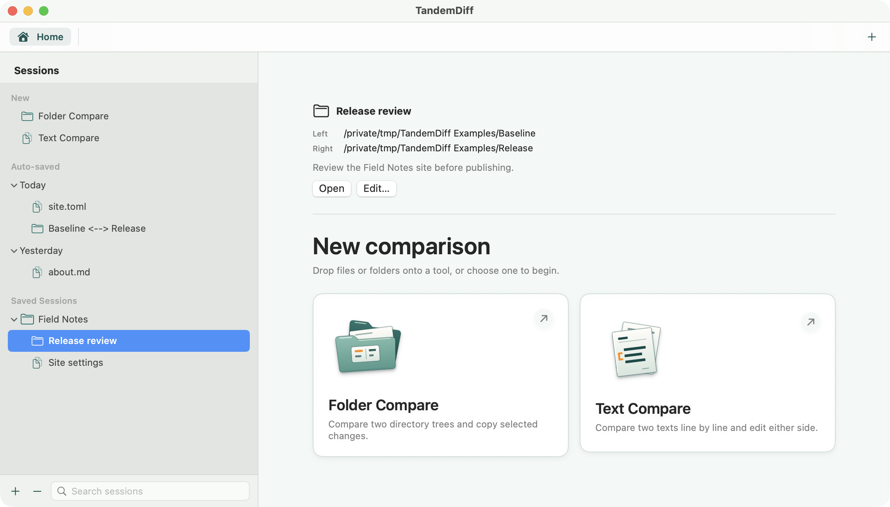
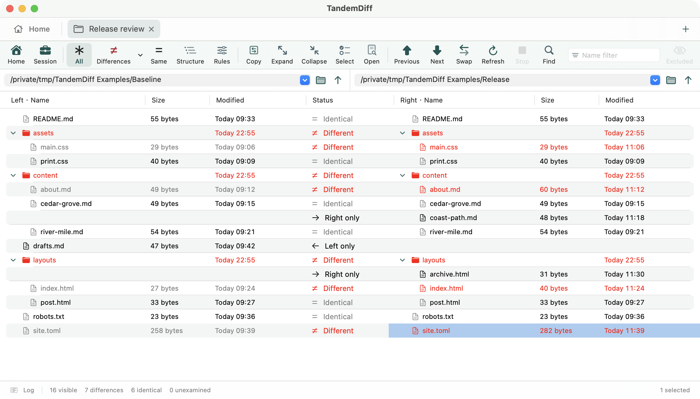
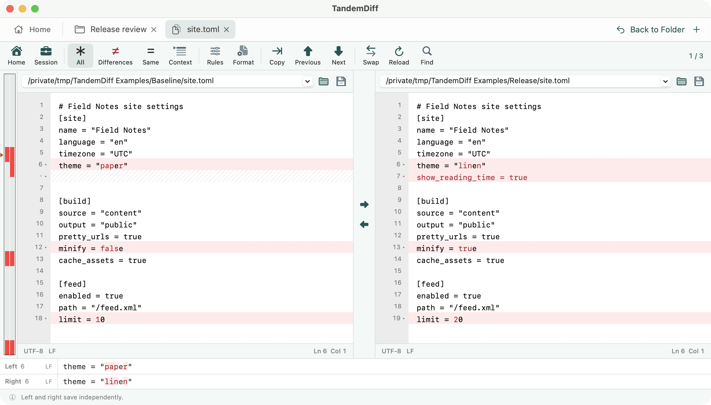

# TandemDiff

[简体中文](README.zh-CN.md) · [Build from source](#build-from-source) · [Changelog](CHANGELOG.md)

TandemDiff is a native Mac app for comparing two copies of a folder or text file. Find the files that changed, open a pair side by side, and bring across just the edits you want to keep. Comparisons run locally.



Drop two folders or two text files onto Home, then confirm which one goes on the left. If you compare the same pair regularly, save the session. The next time you open it, TandemDiff restores the paths, filters, and selected folder row.

## Find what changed in a folder

The folder view lines up matching paths. In this example, `drafts.md` exists only in the baseline, `coast-path.md` is new in the release, and the two copies of `site.toml` differ. For eligible text files, TandemDiff compares the bytes on disk, even when the size and modification time match.



Open **Name Filters** to set file and folder rules separately. Enter `build` under **Exclude folders** to hide build directories, or `*.log` under **Exclude files** to hide log files. Enter one pattern per line, then choose **Apply**. To copy whole files, select the rows and choose a direction. The preview lists the destinations and any files TandemDiff will skip before you confirm.

## Keep one text change at a time

Open a changed file directly from the folder view. In the example below, the theme changes from `paper` to `linen`. The overview at the left marks the other changes, and the detail at the bottom shows exactly which characters differ.



Apply a change to either pane or edit the text directly. You can undo the edit and save each file independently. By default, **Esc** takes you back to the selected folder row. To compare snippets, open a blank **Text Compare** session and paste into both panes.

## Build from source

Use a Mac with Xcode and the macOS SDK. The package declares Swift tools 5.10. Run this command from the root of the checkout.

```sh
./script/build_and_run.sh
```

The script builds and opens `dist/TandemDiff.app`. To run the tests or build a Universal app without launching it, use the following commands.

```sh
swift test
./script/build_and_run.sh --universal --build-only
```

| | Support |
| --- | --- |
| Build target | macOS 14.0 or later. The Universal build includes Apple silicon and Intel. |
| Tested locally | Apple M5, macOS 27.0.1, Xcode 27.2. |
| Automated tests | The Swift test suite passed on GitHub-hosted Apple silicon (macOS 15) and Intel (macOS 26) runners. |
| Still to verify | Interactive use on an Intel Mac and running TandemDiff on macOS 14. |
| Inputs | Local APFS folders. The editor accepts UTF-8 and BOM-tagged UTF-16, up to 16 MiB and 200,000 logical lines per side. Paired binary files are listed as **Not compared**. |
| Interface | English and Simplified Chinese, with light and dark appearances. Change either in **TandemDiff → Settings**. |

Local builds use an ad hoc signature. See [compatibility and distribution](docs/compatibility.md) for verification commands and binary release requirements.

## Contributing

For a comparison bug, include the smallest pair of sample files that shows it, the result you expected, your macOS version, and your Mac’s CPU. The [development guide](AGENTS.md) lists the source modules and the checks to run for each kind of change. The [design](docs/design.md) explains the comparison and write rules, and the [acceptance checks](docs/acceptance.md) include cases you can reproduce.

## License

The [MIT License](LICENSE) covers the code and project-owned assets, including the [app icon](assets/TandemDiff.png) and the project-owned portions of the screenshots. The icon was generated for TandemDiff. The screenshots show the app running with sample files.
