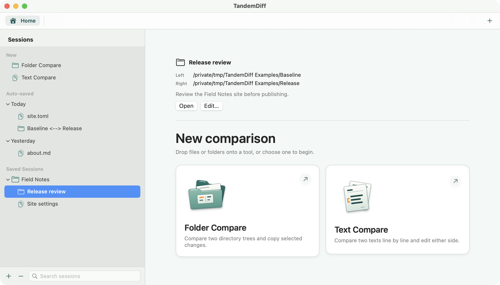
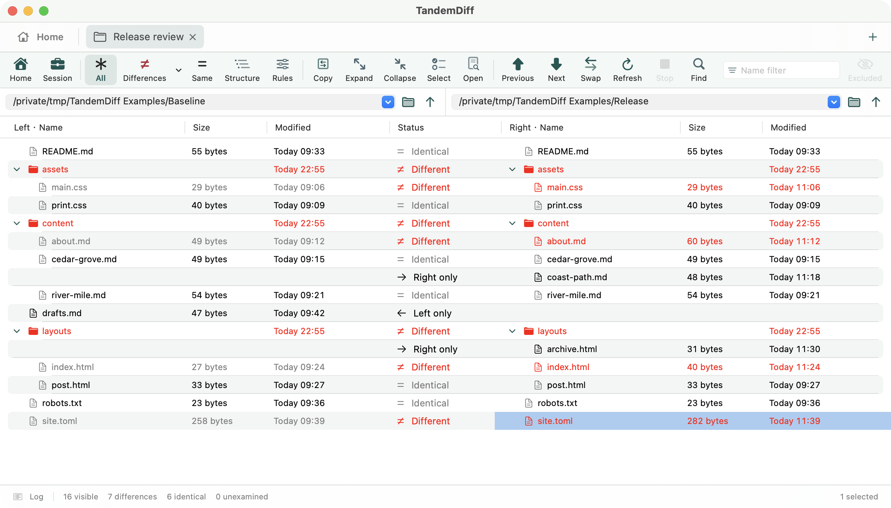
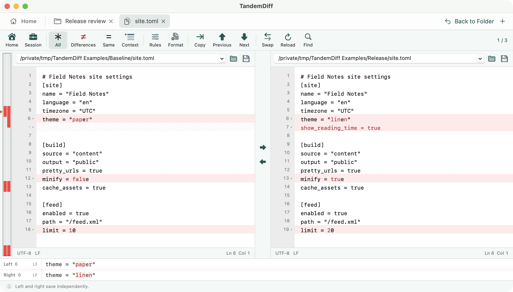

# TandemDiff

[English](README.md) · [下载安装包](https://github.com/willaaaaaaaaa/TandemDiff/releases/latest) · [从源码运行](#从源码运行) · [更新日志](CHANGELOG.md)

TandemDiff 是一款原生 Mac 文件比较工具。把同一项目的两个版本并排打开，先找出哪些文件变了，再点进文件查看具体改动，只把想保留的部分合到另一侧。整个比较过程都在本机完成。



把两个文件夹或两个文本文件拖到主页，确认左右顺序即可开始比较。经常对照同一组文件时，可以保存会话。下次打开时，路径、筛选条件和上次选中的目录行都会恢复。

## 在文件夹里找出变动

两个目录中路径相同的条目会排在同一行。下图中，`drafts.md` 只在基准版本里，`coast-path.md` 是发布版本新增的文件，两边的 `site.toml` 内容也有差异。对于支持的文本文件，即使大小和修改时间相同，TandemDiff 也会按磁盘上的实际字节比较。



打开**名称筛选**，在**排除文件夹**中填 `build` 可隐藏构建目录，在**排除文件**中填 `*.log` 可隐藏日志文件。每行填一条规则，然后点**应用**。要复制整个文件，选中相应的行并指定方向。确认前可以预览目标路径，也能看到哪些文件会跳过。

## 只合入想保留的文字改动

从目录里打开有差异的文件。下图中，主题从 `paper` 改成了 `linen`。左侧概览条标出文件中其他差异的位置，底部则并列显示当前行，方便核对究竟改了哪几个字符。



可以把当前改动应用到任意一侧，也可以直接编辑或撤销。左右文件分别保存。默认设置下，按 **Esc** 会回到刚才选中的目录行。只有两段文字时，打开空白的**文本比较**会话，把内容分别粘贴到两侧即可。

## 从源码运行

不想自行构建时，可从 [GitHub Releases](https://github.com/willaaaaaaaaa/TandemDiff/releases/latest) 下载最新的通用版安装包。要从源码构建，准备一台已安装 Xcode 和 macOS SDK 的 Mac。项目声明的 Swift 工具版本是 5.10。在仓库根目录执行以下命令。

```sh
./script/build_and_run.sh
```

脚本会构建并打开 `dist/TandemDiff.app`。需要运行测试或仅构建通用版本时，使用以下命令。

```sh
swift test
./script/build_and_run.sh --universal --build-only
```

| 项目 | 范围 |
| --- | --- |
| 构建目标 | macOS 14.0 起。通用构建包含 Apple 芯片和 Intel 两种架构。 |
| 本机实测 | Apple M5、macOS 27.0.1、Xcode 27.2。 |
| 自动化测试 | Swift 测试已在 GitHub 托管的 Apple 芯片（macOS 15）和 Intel（macOS 26）环境中通过。 |
| 待验证 | Intel Mac 上的桌面交互，以及 TandemDiff 在 macOS 14 上的运行情况。 |
| 输入 | 本地 APFS 目录。编辑器支持 UTF-8 和带 BOM 的 UTF-16，每侧上限为 16 MiB、20 万个逻辑行。两边都有的二进制文件会标为**未比较**。 |
| 界面 | 支持简体中文、英文及浅色、深色外观，可在 **TandemDiff → 设置**中切换。 |

本地构建使用临时签名（ad hoc）。验证命令与可下载版本的发布要求见[兼容性与分发说明](docs/compatibility.md)。

## 参与项目

报告比较问题时，请附上能复现问题的最小示例文件、预期结果、macOS 版本和 Mac 芯片型号。[开发指南](AGENTS.md)列出了源码模块和各类改动的验证方法。[设计说明](docs/design.md)记录了比较和写入规则，[验收用例](docs/acceptance.md)提供了可复现的场景。

## 许可证

项目代码和自有素材统一采用 [MIT 许可证](LICENSE)，包括[应用图标](assets/TandemDiff.png)及截图中属于项目的部分。图标为 TandemDiff 项目生成，以上截图均取自使用示例文件的应用窗口。
